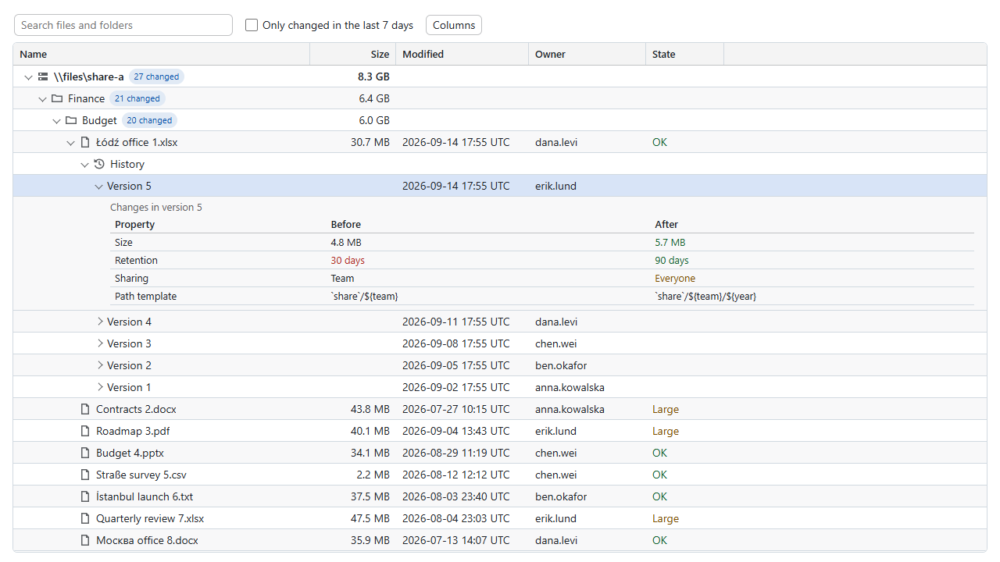
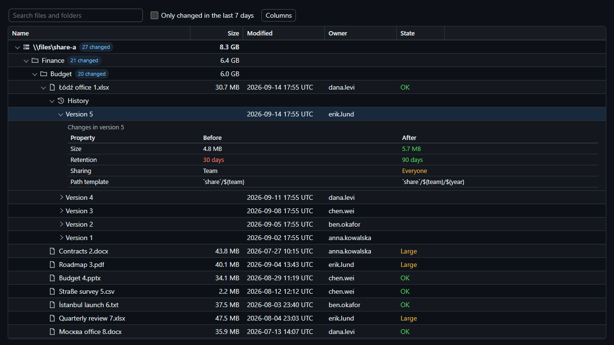
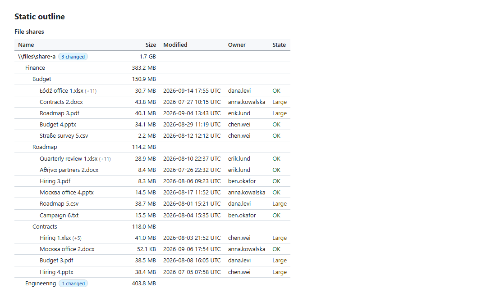

# CanopyX - Interactive Trees and Data Grids

Turn application data into searchable trees, sortable tables and standalone HTML reports. Use C# to write a report you can open in a browser, or mount the JavaScript runtime in your own page.

📦 **.NET packages**

[](https://www.nuget.org/packages/CanopyX)
[](https://www.nuget.org/packages/CanopyX.Html)

🌐 **JavaScript package**

[](https://www.npmjs.com/package/@evotecit/canopyx)
[](https://opensource.org/license/mit)

## What you can build

- **File and folder explorers** with expandable branches, lazy loading, search and multi-selection.
- **Inventory and results tables** with typed sorting, filters, column resizing and saved views.
- **HTML reports** that include their own runtime and data and can be opened from disk or a file share.
- **Application views** backed by paged or cursor-based data sources, with selection and detail callbacks.
- **Email and print tables** rendered from the same .NET view without JavaScript.



The same explorer in the dark theme, alongside its script-free output for email and print:

| Dark theme | Static outline |
| --- | --- |
|  |  |

## Features

| | Tree grid | Data grid |
| --- | --- | --- |
| Navigation | Expandable branches, path search and lazy children | Continuous or paged records, offset or cursor navigation |
| Querying | Search, sibling sorting and named filters | Search, multi-column sorting, typed filters and condition groups |
| Columns | Resize and hide | Resize, hide, reorder, pin, fit to content and group under multi-level headers |
| Selection | Single/multiple selection and hierarchical checkboxes | Single/multiple selection with stable record IDs, and cell ranges with copy, paste and a fill handle |
| Presentation | Badges, details, custom cells and light/dark themes | Links, progress, wrapped text, row highlighting, conditional formatting and light/dark themes |
| Grouping and details | Nested branches and detail rows | Multi-level row groups with labelled aggregates, and expandable detail rows holding a template, HTML or a nested grid or tree |
| Delivery | Single HTML file, sidecar bundle or hosted data | Single HTML file, row-chunk sidecar bundle or hosted data |

Both views use virtual rows and support keyboard navigation. Both can mark search and filter matches with a match count and next/previous navigation ([search highlighting](docs/search-highlight.md)), and let readers switch between fitting the width, scrolling sideways and (on grids) cards, in three densities ([layout modes](docs/layout-modes.md)). Reporting grids also provide multi-level grouping with aggregates, detail rows, saved views, CSV export and row copying (see [docs/grouping.md](docs/grouping.md)). Grids and trees can open each record in a record panel: record-only fields in tabs and sections, lists, objects and nested collections, links between records, timelines, record deep links, and copy, print and export of one record, with details loaded on demand for large reports (see [docs/record-panel.md](docs/record-panel.md)). English labels are built in; Polish, German, Spanish, French and Italian packs are included.

## Installation

### .NET

```shell
dotnet add package CanopyX.Html
```

`CanopyX.Html` includes the browser assets and brings in `CanopyX` for the view definitions. Install `CanopyX` alone when you only need the model, tree bundle writer or script-free table renderer.

| Target | Support |
| --- | --- |
| .NET 8 and .NET 10 | Windows, Linux and macOS |
| .NET Standard 2.0 | Compatible .NET applications |
| .NET Framework 4.7.2 | Windows |

Neither .NET package adds third-party runtime dependencies. Generating a report from C# needs no Node.js, npm or JavaScript build step.

To serve a hosted grid from your own data, add `CanopyX.Data` (server-side paging, sorting, filtering, value lists, multi-level summaries, streamed export and commits of edited rows over `IQueryable<T>` or your own provider) and, in ASP.NET Core, `CanopyX.AspNetCore` for the endpoints. See [Server-side data for .NET](docs/remote-dotnet.md).

### JavaScript

```shell
npm install @evotecit/canopyx
```

The package includes ES modules, classic scripts, stylesheets and TypeScript declarations, with no runtime package dependencies.

## Usage in .NET

### Create a file explorer

```csharp
using CanopyX;
using CanopyX.Html;

var files = new CanopyTreeView("files", "Project files");
files.Search = new CanopySearchOptions();
files.Columns.Add(new CanopyColumn("name", "Name") { Sortable = true });
files.Columns.Add(new CanopyColumn("size", "Size")
{
    Kind = CanopyColumnKind.Number,
    Sortable = true
});

var projects = new CanopyNode("projects", "Projects");
var report = new CanopyNode("quarterly-report", "Quarterly report.pdf");
report.Cells["size"] = new CanopyCell(2048L) { Text = "2 KiB" };
projects.Children.Add(report);
files.Roots.Add(projects);

files.SaveHtmlPage("files.html");
```

Open `files.html` in a browser and expand Projects. The first column displays the node label; the Size column displays the matching cell. Numeric values control sorting while `Text` controls the displayed value.

For a larger tree, write a bundle that loads branches on demand:

```csharp
files.SaveHtmlBundle("file-report");
```

Keep the generated page, assets and data files together. The bundle can be opened directly from disk or a file share.

### Create an inventory table

```csharp
using CanopyX;
using CanopyX.Html;

var inventory = new CanopyDataGridView("inventory", "Inventory");
inventory.Columns.Add(new CanopyColumn("name", "Name") { Sortable = true });
inventory.Columns.Add(new CanopyColumn("size", "Size")
{
    Kind = CanopyColumnKind.Number,
    Sortable = true
});

foreach (var (name, bytes) in new[] { ("Archive", 2048L), ("Documents", 512L) })
{
    var row = new CanopyGridRow(name);
    row.Cells["name"] = name;
    row.Cells["size"] = new CanopyCell(bytes) { Text = $"{bytes:N0} bytes" };
    inventory.Rows.Add(row);
}

inventory.SaveHtmlPage("inventory.html");
```

Open `inventory.html` to search the records, sort by name or size, and adjust the columns. Record IDs stay stable when the order changes.

### Render a table for email or print

```csharp
using CanopyX.Rendering;

string treeTable = CanopyStaticHtml.Render(files);
string inventoryTable = CanopyStaticHtml.RenderGrid(inventory);
```

These methods return HTML tables with no scripts. Insert the returned HTML into your email, print layout or document-generation workflow.

## Usage in JavaScript

Add a container to your page:

```html
<div id="files" style="height: 360px"></div>
```

Then mount a tree grid:

```javascript
import { createTreeGrid } from "@evotecit/canopyx";
import "@evotecit/canopyx/styles.css";

const grid = createTreeGrid(document.getElementById("files"), {
  view: {
    protocol: "canopyx/2", type: "view", id: "files", label: "Project files",
    rowHeight: 28, pageSize: 100, selection: "single",
    search: { minLength: 1, maxResults: 50 },
    columns: [{ id: "name", title: "Name", kind: "text", width: 320 }],
    source: { kind: "inline" },
    roots: [{
      id: "projects", label: "Projects",
      children: [{ id: "quarterly-report", label: "Quarterly report.pdf" }]
    }]
  }
});

await grid.ready;
```

The stylesheet import uses your application's asset pipeline. For a page without a bundler, serve `classic.js` and `styles.css` from the installed package and load them with `<script>` and `<link>` elements; the script exposes `window.CanopyX`. Use one matching runtime and stylesheet per page.

### Choose a runtime

| Import | Use it for | Stylesheet |
| --- | --- | --- |
| `@evotecit/canopyx` | Interactive tree grids | `@evotecit/canopyx/styles.css` |
| `@evotecit/canopyx/grid` | Flat data grids | `@evotecit/canopyx/grid.css` |
| `@evotecit/canopyx/reporting` | Flat grids with reporting controls | `@evotecit/canopyx/reporting.css` |

Module imports are safe on the server; mounting a view requires a browser. The included TypeScript declarations describe the view, data-source and event APIs.

### Enhance a table, or start from records or a URL

A page that already has an HTML table needs one call. The table's headers, rows, `data-order` and `data-search` values, row ids, caption and footer become a grid with search, filters, sorting, numbered pages and export, and the table stays the script-free fallback:

```html
<link rel="stylesheet" href="canopyx-grid.css">
<script src="canopyx-grid.js"></script>
<script>CanopyX.enhance("#servers", { pageLength: 10, stateSave: true });</script>
```

`CanopyX.grid(element, { data, columns })` builds the same grid from plain records with field paths and render functions, and `url` reads records from an address once or, with `serverSide`, asks it for every page. See [docs/enhance.md](docs/enhance.md) and [docs/paging.md](docs/paging.md).

### Extend it with plugins

`CanopyX.use(plugin)` adds cell renderers that columns choose by name, toolbar buttons, menu entries, export formats and event handlers to every grid and tree on the page; the `plugins` option adds them to one view. Optional features load as separate parts only when a view needs them, so serve the `canopyx-*.js` files beside the runtime (the .NET writers do). See [docs/plugins.md](docs/plugins.md).

### Edit data in a grid

Mark flat-grid columns `editable` and give them typed editors (text, number, date and time, select, toggle, lookup) and validation. Readers edit in the cells (or in the record drawer on phones) with undo and redo; changes stay marked until your callbacks or data source save them through row or batch commits, which report each row's result. CanopyX never writes data itself. See [docs/editing.md](docs/editing.md).

### Format cells by rule

`formatRules` (in .NET, `CanopyDataGridView.FormatRules`) tints cells and rows, adds icons, badges and cues, and draws data bars, colour scales and threshold bands, with conditions from the filter builder. Readers can change the rules in a rule editor, and their rules are kept in saved views. See [docs/conditional-formatting.md](docs/conditional-formatting.md).

### Link views together

A chart, a list or another grid can filter a grid or tree (`setExternalFilter`, shown as a removable chip and sent to a host source in its query) or highlight its rows (`setHighlight`), and a view with `linkEvents` reports its selection and own conditions as neutral `canopyx:linkchange` payloads. See [docs/linked-views.md](docs/linked-views.md).

### Translate the controls

Import labels from `@evotecit/canopyx/locales/pl`, `/locales/de`, `/locales/es`, `/locales/fr` or `/locales/it` and pass them as `labels` in your view definition. In C#, set the view's `Labels` to `CanopyLabels.Polish()`, `German()`, `Spanish()`, `French()` or `Italian()` before writing the page.

### Strict security policies and accessibility

CanopyX runs under a Content Security Policy without `'unsafe-inline'` or `'unsafe-eval'`: set `CanopyHtmlOptions.Nonce` in C#, or give the runtime script a nonce, and the parts the runtime loads later carry it too. It also works with Trusted Types (`trusted-types canopyx`), writes host strings as text, and escapes CSV fields that could start a spreadsheet formula. See [docs/security.md](docs/security.md). The keyboard model, ARIA roles, forced colours, reduced motion, zoom reflow and target sizes, and what the tests check, are in [docs/accessibility.md](docs/accessibility.md).

## Working with larger datasets

Virtual rows keep the rendered DOM small. Tree bundles split data into sidecar files, and hosted sources let your application fetch records as the reader navigates. Flat-grid queries filter and sort the complete dataset before paging; loading one page does not mean the rest of the results are available in the browser.

`CanopyX.Data` answers a hosted grid's queries on the server, so a table over millions of database rows pages, sorts, filters, groups, counts value lists and exports without loading the result into the browser, and saves the rows readers edit through a writer the host controls ([docs/remote-dotnet.md](docs/remote-dotnet.md)).

Large single-file reports have three more choices: views that mount only when they come into view (`MountWhenVisible`), compact row data that the browser decodes chunk by chunk after the first rows have painted, optionally gzip-compressed (`RowData`), and grid bundles whose rows load from sidecar files (`SaveHtmlBundle`). See [docs/large-data.md](docs/large-data.md) for when to use which, with measured numbers.

CSV export and copying distinguish filtered results, selected records and all records. Register your own export formats, such as an Excel or PDF writer, with `CanopyX.registerExportFormat`, and they join the grid's Export menu with the same scope choice, progress and cancellation; tree grids export their visible, selected or all rows through the same writers. For application actions, connect your own callbacks to the view.

## Documentation

- [Features](docs/features.md): everything the tree and data grids do, grouped by capability.
- [Recipes](docs/recipes.md): short how-tos for server data, cell values, export, phones, grouping, saved views and translations.
- [Authoring reference](docs/authoring.md), [column layout](docs/column-layout.md), [label packs](docs/labels.md) and the [data protocol](docs/data-protocol.md).
- [Planned work](TODO.md): remaining capabilities, consumers and acceptance gates.
- [Testing and benchmarks](docs/testing.md): the required correctness loop and explicit performance measurements.

## Community and license

CanopyX is an Evotec project, licensed under MIT. Questions and feedback are welcome in the [Evotec community on Discord](https://evo.yt/discord). You can find more Evotec projects and articles at [evotec.xyz](https://evotec.xyz/hub).
